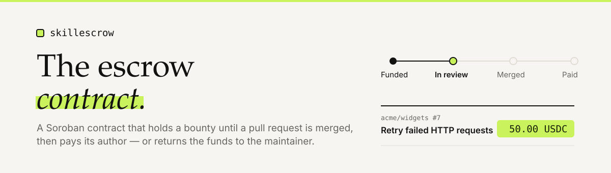
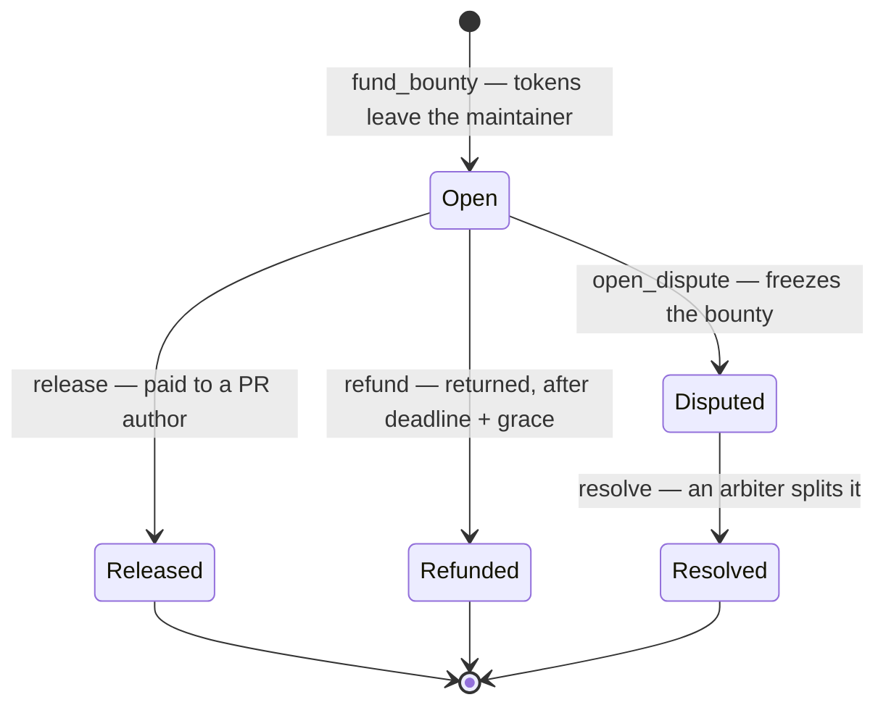

<picture>
  <source media="(prefers-color-scheme: dark)" srcset="docs/img/banner-dark.svg">
  
</picture>

<p align="center">
  <b>The Soroban contract behind <a href="https://github.com/Soroban-escrow/escrow-app">SkillEscrow</a>.<br>
  It holds a bounty on a GitHub issue until a maintainer merges a pull request.</b>
</p>

<p align="center">
  <a href="#quick-start">Quick start</a> ·
  <a href="#entry-points">Entry points</a> ·
  <a href="#the-rules-that-protect-the-money">The rules</a> ·
  <a href="#trust-model">Trust model</a> ·
  <a href="#testing">Testing</a>
</p>

---

## What it does

One maintainer locks tokens against one GitHub issue. From there exactly four things can happen,
and the contract enforces that nothing else can:



The off-chain application decides *who* the winner is — by watching GitHub for a merge. The contract
decides *whether a payment is allowed at all*, and that is the part you should audit.

| | |
|---|---|
| **Deployed on testnet** | [`CCEKBPYC…ZF3J4RKN`](https://stellar.expert/explorer/testnet/contract/CCEKBPYCWKNTXIQLXJHVAF7RYGUZZ6MITA7VVJBOK5BHXUO44ELZ4F4V) |
| **Size** | 21,408 bytes of Wasm, 23 entry points |
| **Tests** | 63, including a property test of the funds invariant |
| **Built with** | Rust 1.99.1 · `soroban-sdk` 29.0.1 · target `wasm32v1-none` |
| **Audited** | ❌ **No.** See [Before mainnet](#before-mainnet). |

---

## Quick start

```bash
# Rust 1.99.1 installs itself from rust-toolchain.toml, with the wasm32v1-none target.
# You also need the Stellar CLI 28.1.0:  brew install stellar-cli

./scripts/build.sh    # optimised Wasm; prints the size and sha256
cargo test            # 63 tests
cargo clippy --all-targets -- -D warnings
cargo fmt --check
```

> **Run `./scripts/build.sh` before `cargo test`.** The upgrade test embeds the built Wasm, so the
> file has to exist. CI does the same, in that order.

### Deploying your own

```bash
./scripts/deploy-testnet.sh    # deploy + init + allowlist native XLM, writes deployments/testnet.json
./scripts/smoke-testnet.sh     # fund → release and fund → dispute → resolve, against the real network
./scripts/bindings.sh          # regenerate the TypeScript client into ../skillescrow-app
```

`deploy-testnet.sh` expects four Stellar CLI identities — `se-testnet-admin`, `se-testnet-arbiter`,
`se-testnet-treasury`, `se-testnet-relayer`. Create them with `stellar keys generate <name> --network testnet --fund`.
Set `TESTNET_USDC` to a verified USDC SAC id to allowlist USDC as well.

`deploy-mainnet.sh` refuses to run without `--i-have-human-approval` *and* a typed confirmation.

---

## Entry points

### Moving money

| Function | Who may call it | What the contract checks |
|---|---|---|
| `fund_bounty(maintainer, repo_id, issue, token, amount, deadline, relayer_allowed) -> id` | maintainer | Not paused · token allowlisted · `min ≤ amount ≤ max` · deadline within the allowed window · **no active bounty already on this issue**. Snapshots the current fee. |
| `release(caller, bounty_id, winner)` | maintainer, **or** the relayer if `relayer_allowed` | Status is `Open` · the winner is neither the maintainer nor the contract itself. Allowed *after* the deadline too, as long as no refund has happened. |
| `refund(maintainer, bounty_id)` | maintainer only | Status is `Open` · `now ≥ deadline + grace`. Returns the full amount, **no fee**. Works while paused. |
| `open_dispute(caller, bounty_id)` | maintainer or arbiter | Status is `Open`. Freezes release *and* refund. |
| `resolve(arbiter, bounty_id, winner, winner_bps)` | arbiter only | Status is `Disputed` · `winner_bps ≤ 10000` · a winner is required when `winner_bps > 0`. Works while paused. |

### Reading

`get_bounty(id)` · `active_bounty(repo_id, issue)` · `get_config()` · `get_totals(token)` · `get_token(token)` — all public, no auth.

### Administration

`init` · `set_token` · `remove_token` · `set_fee` · `set_relayer` · `set_arbiter` · `set_treasury` ·
`set_grace` · `set_durations` · `set_admin` · `pause` · `unpause` · `upgrade`

`set_admin` requires **both** the current and the incoming admin to sign, so a typo cannot lock the
contract. `pause` blocks `fund_bounty` and nothing else.

### Errors

Stable numbering — **never renumbered after deploy**, because clients map on the number:

```
 1 AlreadyInitialized    7 AmountTooLarge     13 SelfPayout
 2 NotInitialized        8 InvalidDeadline    14 InvalidSplit
 3 Unauthorized          9 IssueAlreadyFunded 15 InvalidFee
 4 Paused               10 BountyNotFound     16 Overflow
 5 TokenNotAllowed      11 InvalidStatus      17 RelayerNotAllowed
 6 AmountTooSmall       12 DeadlineNotReached
```

### Events

Every state change emits one, with enough data that an indexer never needs a follow-up read:
`funded` · `released` · `refunded` · `disputed` · `resolved` · `config` · `paused` · `unpaused` · `upgraded`.

---

## The rules that protect the money

### Fees

```
fee(amount, bps) = floor(amount × bps ÷ 10_000)      checked arithmetic; Overflow on failure
net              = amount − fee                       rounding dust goes to the contributor
portion(winner)  = floor(amount × winner_bps ÷ 10_000) dust stays with the maintainer
```

The fee is **snapshotted when the bounty is funded**. An admin raising the fee afterwards cannot
touch a bounty that already exists. Cap is 10% (`fee_bps ≤ 1000`); production config is 3%.

The same fee vectors are shared with the TypeScript side of the app, so both implementations are
tested against one source of truth.

### The accounting invariant

Per token, after **every** state change:

```
funded == released_net + fees + refunded + held
held   == the contract's actual token balance
```

A property test runs random sequences of fund / release / refund / dispute / resolve across two
tokens and asserts this after every single step — plus that the total token supply never changes and
that the per-issue lock is held exactly while a bounty is live.

### Storage lifetime

Ledgers close about every 5 s — 17,280 a day. The longest a bounty can need to live is
90 days (max duration) + 3 days (grace) = **93 days**. Entries are extended to **120 days** whenever
fewer than 30 days remain, so a bounty can never expire out from under its funds. Those numbers are
checked at compile time against the network's maximum entry TTL.

---

## Trust model

Stated plainly, because an escrow contract is only as honest as its documentation.

| Role | Power | Bound by |
|---|---|---|
| **Admin** | Changes config, pauses funding, and **can upgrade the contract code** — so in effect controls escrowed funds | Nothing in the contract. **Must become a multisig before mainnet.** |
| **Relayer** | Releases bounties automatically when a PR is merged | Only bounties where the maintainer set `relayer_allowed`; only to a non-maintainer address; bounded by the per-token `max_amount` |
| **Arbiter** | Opens a dispute on any `Open` bounty and splits it | Cannot touch an undisputed bounty; splits are capped at 100% |
| **Maintainer** | Funds, releases, refunds, disputes | Cannot pay themselves; cannot refund before `deadline + grace` |

**Funds can always leave.** Pausing stops new funding only — `refund` and `resolve` keep working
regardless. There is no function that can trap a funded bounty.

**The maintainer chooses their own exposure.** `relayer_allowed` is set per bounty at funding time.
Opt out and the relayer key is worthless against that bounty; the maintainer signs the release.

---

## Testing

```bash
./scripts/build.sh && cargo test
```

| Area | Tests | Covers |
|---|---|---|
| `fund` | 9 | Pause, allowlist, min/max bounds, deadline window, the one-bounty-per-issue lock, auth |
| `release` | 12 | Maintainer and relayer paths, self-payout, the contract as winner, double release, fee snapshot |
| `refund` | 8 | The exact `deadline + grace` boundary, works while paused, no fee taken, ordering against release |
| `dispute` | 14 | Who may open, splits at 0 / 5000 / 10000 bps with exact arithmetic, non-arbiter rejection |
| `admin` | 14 | Init once, fee cap, two-party `set_admin`, token removal, a real `upgrade` |
| `invariants` | 1 | Property test — random operation sequences, checked after every step |

Auth is tested two ways: `env.mock_all_auths()` where authorisation is not the subject, and
`env.set_auths(&[])` where it is, so an auth check cannot silently disappear.

---

## Before mainnet

- [ ] **External audit.** This contract has not had one.
- [ ] Admin moved to a multisig account — it can upgrade the code.
- [ ] Per-token `max_amount` starting at 500 USDC.
- [ ] USDC contract id verified against Circle's own documentation, not copied from a search result.
- [ ] Relayer key in a KMS/HSM.
- [ ] Re-check the TTL numbers against mainnet network settings.

`cargo audit` passes with one documented exception: `RUSTSEC-2026-0387` (`crypto-bigint` 0.5.5) is
reached only through the SDK's **test** host, is not in the deployed Wasm, and cannot be bumped until
upstream moves. The justification lives in [`.cargo/audit.toml`](.cargo/audit.toml) and is re-checked
on every SDK upgrade.

---

## Related

| | |
|---|---|
| **Application** | [Soroban-escrow/escrow-app](https://github.com/Soroban-escrow/escrow-app) — API, worker, web app, AI review |
| **Contract reference** | [`docs/CONTRACT.md`](docs/CONTRACT.md) — every entry point, error, event and TTL number |
| **Build log** | [`docs/PROGRESS.md`](docs/PROGRESS.md) |
