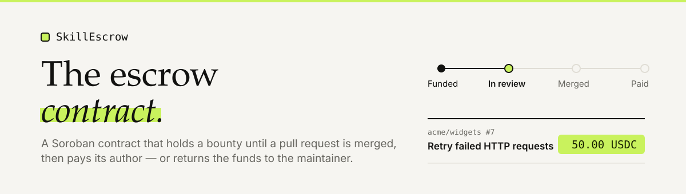
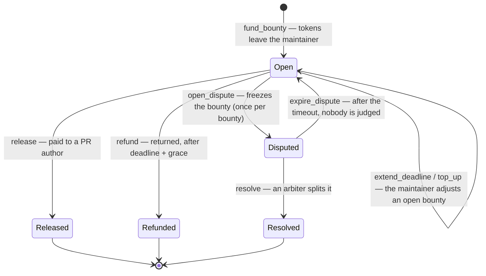

<picture>
  <source media="(prefers-color-scheme: dark)" srcset="docs/img/banner-dark.svg">
  
</picture>

<p align="center">
  <b>The Soroban contract behind <a href="https://github.com/Soroban-escrow/escrow-app">SkillEscrow</a>.<br>
  It holds a bounty on a GitHub issue until a maintainer merges a pull request.</b>
</p>

<p align="center">
  <a href="#quick-start">Quick start</a> ·
  <a href="#entry-points">Entry points</a> ·
  <a href="#the-rules-that-protect-the-money">The rules</a> ·
  <a href="#trust-model">Trust model</a> ·
  <a href="#testing">Testing</a>
</p>

---

## What it does

One maintainer locks tokens against one GitHub issue. From there exactly four things can happen,
and the contract enforces that nothing else can:



The off-chain application decides *who* the winner is — by watching GitHub for a merge. The contract
decides *whether a payment is allowed at all*, and that is the part you should audit.

| | |
|---|---|
| **Deployed on testnet** | [`CCEKBPYC…ZF3J4RKN`](https://stellar.expert/explorer/testnet/contract/CCEKBPYCWKNTXIQLXJHVAF7RYGUZZ6MITA7VVJBOK5BHXUO44ELZ4F4V) |
| **Size** | 35,115 bytes of Wasm (40 KiB CI gate), 30 entry points |
| **Tests** | 63, including a property test of the funds invariant |
| **Built with** | Rust 1.99.1 · `soroban-sdk` 29.0.1 · target `wasm32v1-none` |
| **Audited** | ❌ **No.** See [Before mainnet](#before-mainnet). |

---

## Quick start

```bash
# Rust 1.99.1 installs itself from rust-toolchain.toml, with the wasm32v1-none target.
# You also need the Stellar CLI 28.1.0:  brew install stellar-cli

make check   # build, reproducible build, docs, fmt, clippy, tests and shellcheck
```

`make check` runs the same order as CI. `make ci` additionally runs `cargo deny check`
and `cargo audit`, so install those two tools first. The individual targets are listed in
`make help`; `cargo llvm-cov --package bounty_escrow` remains the optional coverage command.

### Windows

Native Windows can run `cargo` directly, but the build, deploy and smoke scripts are bash. Pick one:

- **WSL2 (recommended):** install Ubuntu from the Microsoft Store and follow the Quick start inside it.
- **Git Bash + native Rust:** install [rustup](https://rustup.rs) for Windows and Git for Windows. Run the
  scripts from Git Bash, for example `./scripts/build.sh`. Install the Stellar CLI 28.1.0 with
  `cargo install --locked stellar-cli --version 28.1.0` or from its v28.1.0 release page.

Two gotchas on Windows:

- Clone with LF line endings. With `core.autocrlf=true`, the `.sh` scripts get CRLF endings and fail
  with `$'\r': command not found`. Fix with `git config core.autocrlf input` and re-clone.
- `rust-toolchain.toml` installs the pinned toolchain and the `wasm32v1-none` target automatically, so
  you do not need to add the target by hand.

> **Run `./scripts/build.sh` before `cargo test`.** The upgrade test embeds the built Wasm, so the
> file has to exist. CI does the same, in that order.

### Deploying your own

```bash
./scripts/deploy-testnet.sh    # deploy + init + allowlist native XLM, writes deployments/testnet.json
./scripts/smoke-testnet.sh     # fund → release and fund → dispute → resolve, against the real network
./scripts/bindings.sh          # regenerate the TypeScript client into ../skillescrow-app
```

`deploy-testnet.sh` refuses to run if its deployment record already exists, because a new deploy would
leave the recorded contract behind. To deploy a new contract and replace the record, set `OVERWRITE_DEPLOYMENT=1`.

`deploy-testnet.sh` expects four Stellar CLI identities — `se-testnet-admin`, `se-testnet-arbiter`,
`se-testnet-treasury`, `se-testnet-relayer`. Create them with `stellar keys generate <name> --network testnet --fund`.
Set `TESTNET_USDC` to a verified USDC SAC id to allowlist USDC as well.

The deploy and smoke scripts are network-aware. `NETWORK` defaults to `testnet`; `KEY_PREFIX` defaults
to `se-<network>-`; `DEPLOYMENT_FILE` defaults to `deployments/<network>.json`. For example, against a
local Quickstart network:

```bash
stellar container start local
make smoke-local              # creates se-local-* identities, deploys and runs the smoke test
stellar container stop local
```

`make smoke-local` overwrites `deployments/local.json` (ignored by git) so it can be rerun against a
fresh local ledger. The local network is also exercised by the `smoke-local` CI job.

`deploy-testnet.sh` also reads these optional init parameters. Each defaults to the value the script
has always used. The effective values are printed before the deploy transaction is sent.

| Variable | Default | Meaning |
|---|---|---|
| `FEE_BPS` | `300` | Fee in basis points passed to `init` (3%). Must be at most `1000`. |
| `GRACE_SECS` | `259200` | Grace period after a bounty deadline, in seconds (3 days). |
| `MIN_DURATION_SECS` | `86400` | Shortest allowed bounty duration, in seconds (1 day). |
| `MAX_DURATION_SECS` | `7776000` | Longest allowed bounty duration, in seconds (90 days). |
| `TOKEN_MIN` | `10000000` | Minimum funding amount per token, in stroops (1 USDC at 7 decimals). Applied to USDC if set, and to native XLM. |
| `TOKEN_MAX` | `5000000000` | Maximum funding amount per token, in stroops (500 USDC at 7 decimals). Applied to USDC if set, and to native XLM. |

Example: `FEE_BPS=500 GRACE_SECS=86400 ./scripts/deploy-testnet.sh`

`deploy-mainnet.sh` refuses to run without `--i-have-human-approval` *and* a typed confirmation.

---

## Entry points

### Moving money

| Function | Who may call it | What the contract checks |
|---|---|---|
| `fund_bounty(maintainer, repo_id, issue, token, amount, deadline, relayer_allowed) -> id` | maintainer | Not paused · token allowlisted · `min ≤ amount ≤ max` · deadline within the allowed window · **no active bounty already on this issue**. Snapshots the current fee. |
| `release(caller, bounty_id, winner)` | maintainer, **or** the relayer if `relayer_allowed` | Status is `Open` · the winner is neither the maintainer nor the contract itself. Allowed *after* the deadline too, as long as no refund has happened. |
| `release_split(caller, bounty_id, winners)` | same as `release` | 1–5 unique winners; shares total 10,000 bps. One fee is charged and rounding dust goes to the first winner. |
| `refund(maintainer, bounty_id)` | maintainer only | Status is `Open` · `now ≥ deadline + grace`. Returns the full amount, **no fee**. Works while paused. |
| `open_dispute(caller, bounty_id)` | maintainer or arbiter | Status is `Open`. Freezes release *and* refund. |
| `resolve(arbiter, bounty_id, winner, winner_bps)` | arbiter only | Status is `Disputed` · `winner_bps ≤ 10000` · a winner is required when `winner_bps > 0`. Works while paused. If the winner's transfer fails (for example, no trustline), the net becomes a claim instead of reverting. |
| `extend_deadline(maintainer, bounty_id, new_deadline)` | maintainer only | Status is `Open` · `new_deadline > deadline` (extend only) · `new_deadline ≤ now + max_duration`. Emits `deadline_extended`. |
| `top_up(maintainer, bounty_id, extra)` | maintainer only | Status is `Open` · `extra > 0` · not paused · token still allowlisted · new total ≤ the token's `max_amount` · at most 10 top-ups per bounty. The fee snapshot does not change. Emits `topped_up`. |
| `expire_dispute(caller, bounty_id)` | anyone | Status is `Disputed` · `now ≥ opened_at + dispute_timeout`. Returns the bounty to `Open`. A bounty can be disputed only once. Emits `dispute_expired`. |
| `claim(winner, bounty_id)` | the winner of a deferred payout | A claim exists · it is unclaimed · the caller is the recorded winner. Pays the deferred net. Emits `claimed`. |
| `set_dispute_timeout(admin, secs)` | admin | `secs > 0`. Defaults to 14 days until set. |

### Reading

`get_bounty(id)` · `active_bounty(repo_id, issue)` · `get_config()` · `get_totals(token)` · `get_token(token)` — all public, no auth.

### Administration

`init` · `set_token` · `remove_token` · `set_fee` · `set_relayer` · `set_arbiter` · `set_treasury` ·
`set_grace` · `set_durations` · `set_relayer_limit` · `set_admin` · `pause` · `unpause` ·
`propose_upgrade` · `execute_upgrade` · `cancel_upgrade`

`set_admin` requires **both** the current and the incoming admin to sign, so a typo cannot lock the
contract. `pause` blocks `fund_bounty` and nothing else.

### Errors

Stable numbering — **never renumbered after deploy**, because clients map on the number:

```
 1 AlreadyInitialized    7 AmountTooLarge     13 SelfPayout
 2 NotInitialized        8 InvalidDeadline    14 InvalidSplit
 3 Unauthorized          9 IssueAlreadyFunded 15 InvalidFee
 4 Paused               10 BountyNotFound     16 Overflow
 5 TokenNotAllowed      11 InvalidStatus      17 RelayerNotAllowed
 6 AmountTooSmall       12 DeadlineNotReached
18 TopUpLimitReached    24 UnexpectedTransferAmount
```

### Events

Every state change emits one, with enough data that an indexer never needs a follow-up read:
`funded` · `released` (with `deferred`) · `refunded` · `disputed` · `resolved` (with `winner_deferred`) · `deadline_extended` · `topped_up` · `dispute_expired` · `claimed` · `config` · `paused` · `unpaused` · `upgraded`.

---

## The rules that protect the money

### Fees

```
fee(amount, bps) = floor(amount × bps ÷ 10_000)      checked arithmetic; Overflow on failure
net              = amount − fee                       rounding dust goes to the contributor
portion(winner)  = floor(amount × winner_bps ÷ 10_000) dust stays with the maintainer
```

The fee is **snapshotted when the bounty is funded**. An admin raising the fee afterwards cannot
touch a bounty that already exists. Cap is 10% (`fee_bps ≤ 1000`); production config is 3%.

The same fee vectors are shared with the TypeScript side of the app, so both implementations are
tested against one source of truth.

### The accounting invariant

Per token, after **every** state change:

```
funded == released_net + fees + refunded + held
held + claimable == the contract's actual token balance
```

`claimable` is the sum of winner payouts that failed to transfer and are waiting for `claim`. A deferred
payout moves its net from `held` to `claimable`, and `claim` moves it to `released_net`. The fee is still
paid when a payout is deferred. `released_net` does not include a deferred payout until it is claimed.

A property test runs random sequences of fund / release / refund / dispute / resolve across two
tokens and asserts this after every single step — plus that the total token supply never changes and
that the per-issue lock is held exactly while a bounty is live.

### Storage lifetime

Ledgers close about every 5 s — 17,280 a day. The longest a bounty can need to live is
90 days (max duration) + 3 days (grace) = **93 days**. Entries are extended to **120 days** whenever
fewer than 30 days remain, so a bounty can never expire out from under its funds. Those numbers are
checked at compile time against the network's maximum entry TTL.

---

## Trust model

Stated plainly, because an escrow contract is only as honest as its documentation.

| Role | Power | Bound by |
|---|---|---|
| **Admin** | Changes config, pauses funding, and proposes contract upgrades | Upgrades wait at least `max_duration + grace`; the delay can only increase. **Must still become a multisig before mainnet.** |
| **Relayer** | Releases bounties automatically when a PR is merged | Only opted-in bounties; optional rolling per-token release cap; maintainer releases bypass the cap |
| **Arbiter** | Opens a dispute on any `Open` bounty and splits it | Cannot touch an undisputed bounty; splits are capped at 100% |
| **Maintainer** | Funds, releases, refunds, disputes | Cannot pay themselves; cannot refund before `deadline + grace` |

**Funds can always leave.** Pausing stops new funding only — `refund` and `resolve` keep working
regardless. There is no function that can trap a funded bounty.

**The maintainer chooses their own exposure.** `relayer_allowed` is set per bounty at funding time.
Opt out and the relayer key is worthless against that bounty; the maintainer signs the release.

---

## Testing

```bash
make check
```

| Area | Tests | Covers |
|---|---|---|
| `fund` | 9 | Pause, allowlist, min/max bounds, deadline window, the one-bounty-per-issue lock, auth |
| `release` | 12 | Maintainer and relayer paths, self-payout, the contract as winner, double release, fee snapshot |
| `refund` | 8 | The exact `deadline + grace` boundary, works while paused, no fee taken, ordering against release |
| `dispute` | 14 | Who may open, splits at 0 / 5000 / 10000 bps with exact arithmetic, non-arbiter rejection |
| `admin` | 14 | Init once, fee cap, two-party `set_admin`, token removal, a real `upgrade` |
| `budgets` | 1 | CPU, memory and ledger read/write budgets for each state-changing entry point, compared with `docs/budgets.json` |
| `invariants` | 1 | Property test — random operation sequences, checked after every step |

Auth is tested two ways: `env.mock_all_auths()` where authorisation is not the subject, and
`env.set_auths(&[])` where it is, so an auth check cannot silently disappear.

### Resource budgets and Wasm size

`docs/budgets.json` stores the committed ceilings for CPU instructions, memory bytes and ledger
read/write entries and bytes. `cargo test --package bounty_escrow budgets -- --nocapture` prints the
table and fails if a metric exceeds its ceiling by more than 10%. After an intentional change, refresh
the snapshot deliberately:

```bash
UPDATE_BUDGETS=1 cargo test --package bounty_escrow budgets -- --nocapture
```

CI runs `scripts/check-wasm-size.sh` after the build. It fails above 40 KiB and writes the size,
headroom and SHA-256 to the job summary. The mainnet resource limits are listed next to the budget
table in [`docs/CONTRACT.md`](docs/CONTRACT.md#resource-budgets).

### Continuous integration

`.github/workflows/ci.yml` runs on every pull request and on pushes to `fresh-build` and `main`. A newer
push to the same PR cancels the older run, and Cargo's registry and `target/` are cached, keyed on
`rust-toolchain.toml` and `Cargo.lock`.

| Job | What it checks |
|---|---|
| `test` | Build, Wasm size gate, reproducible build, contract docs, deploy-script tests, `cargo fmt`, `cargo clippy` (strict lints, `-D warnings`), `cargo test` (including the resource-budget snapshot) |
| `coverage` | `cargo llvm-cov` over the test suite; the lcov, HTML report and summary are uploaded as the `coverage` artifact and shown in the job summary |
| `shellcheck` | `shellcheck` over `scripts/*.sh` and `scripts/tests/*.sh`. Fix warnings, or disable one inline with `# shellcheck disable=SCxxxx` and a comment saying why |
| `audit` | `cargo audit` against the RustSec advisory database |
| `deny` | `cargo deny check` against `deny.toml`: advisories, licences, banned crates and unknown sources |
| `smoke-local` | Starts a local Stellar Quickstart container, deploys, and runs the fund/release and dispute/resolve smoke flow against it |

The clippy lint set (`arithmetic_side_effects`, the `cast_*` lints, `unwrap_used`, `expect_used`, `panic`,
`indexing_slicing`) lives in `[workspace.lints.clippy]` in `Cargo.toml`. Any `allow` must carry a `reason`.

---

## Before mainnet

Run `scripts/deploy-mainnet.sh --dry-run` first. It enforces the items marked **check**; the rest are manual.

- [ ] **External audit.** This contract has not had one. *(manual)*
- [ ] Admin moved to a multisig account and the upgrade delay is long enough for users to exit. *(check: admin is a multisig)*
- [ ] Per-token `max_amount` starting at 500 USDC. *(check: MAX_AMOUNT within cap)*
- [ ] USDC contract id verified against Circle's own documentation. *(check: MAINNET_USDC matches the derived id; the issuer constant itself is manual)*
- [ ] Admin, arbiter, treasury and relayer are four different accounts. *(check)*
- [ ] Wasm matches the reproducible build. *(check: EXPECTED_WASM_SHA256)*
- [ ] Relayer key in a KMS/HSM. *(manual)*
- [ ] Re-check the TTL numbers against mainnet network settings. *(manual)*

`cargo audit` passes with one documented exception: `RUSTSEC-2026-0387` (`crypto-bigint` 0.5.5) is
reached only through the SDK's **test** host, is not in the deployed Wasm, and cannot be bumped until
upstream moves. The justification lives in [`.cargo/audit.toml`](.cargo/audit.toml) and is re-checked
on every SDK upgrade. [`deny.toml`](deny.toml) applies the same exception, plus the licence, banned-crate
and source policy enforced by `cargo deny check`.

---

## Verify what is deployed

```bash
bash scripts/verify-deployment.sh testnet
```

It fetches the Wasm running at the recorded contract id and compares its hash with `deployments/testnet.json`.

## Related

| | |
|---|---|
| **Application** | [Soroban-escrow/escrow-app](https://github.com/Soroban-escrow/escrow-app) — API, worker, web app, AI review |
| **Contract reference** | [`docs/CONTRACT.md`](docs/CONTRACT.md) — every entry point, error, event and TTL number |
| **Build log** | [`docs/PROGRESS.md`](docs/PROGRESS.md) |
