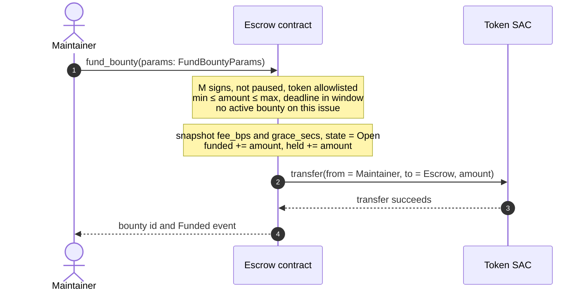
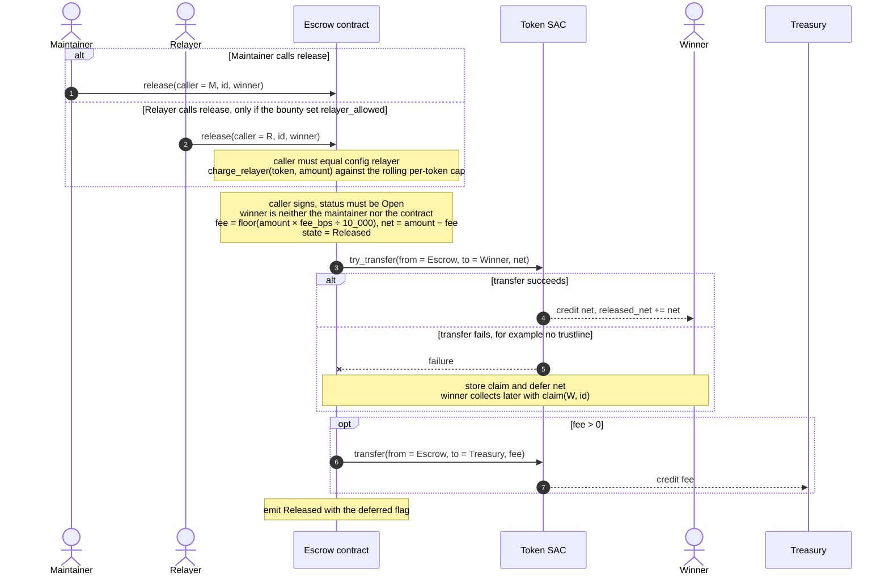
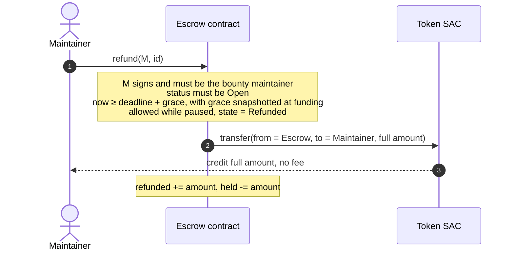
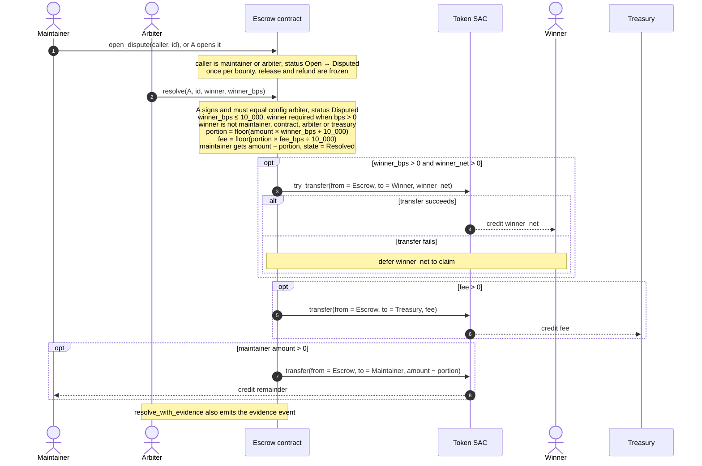

# bounty_escrow contract

Soroban escrow for GitHub issue bounties. soroban-sdk 29.0.1, target `wasm32v1-none`.

## Lifecycle
`Open -> Released | Refunded | Disputed -> Resolved`, plus `Disputed -> Open` when a dispute expires. `Open` bounties can be extended (`extend_deadline`) and topped up (`top_up`). One active bounty per `(repo_id, issue)`.

## Lifecycle sequence diagrams

These render on GitHub. `Escrow` is this contract, `Token SAC` is the token contract, and every token movement is a call from the escrow to the token contract. `try_transfer` failures defer a payout instead of reverting the transaction.

### Fund



### Release — maintainer and relayer callers



### Refund



### Dispute and resolve



`release_split` follows the release flow but transfers one share to each of up to five winners in a single transaction, with all rounding dust assigned to the first winner (see "Fee math").

### ABI change: grouped input structs (#114)

`init` and `fund_bounty` now take a **single** `#[contracttype]` argument, instead of the previous positional arguments. This is an ABI-breaking change for newly built Wasm: callers must update their contract bindings and invocation arguments before deploying or upgrading. The serialized persistent `Config` and `Bounty` layouts, function names, authorization rules, return types, and emitted events are unchanged.

| Entry point | Argument | Struct fields |
|---|---|---|
| `init` | `params: InitParams` | `admin: Address`, `relayer: Address`, `arbiter: Address`, `treasury: Address`, `fee_bps: u32`, `grace_secs: u64`, `min_duration_secs: u64`, `max_duration_secs: u64` |
| `fund_bounty` | `params: FundBountyParams` | `maintainer: Address`, `repo_id: u64`, `issue: u64`, `token: Address`, `amount: i128`, `deadline: u64`, `relayer_allowed: bool` |

Rust clients must now pass references to `InitParams` and `FundBountyParams`. Stellar CLI callers pass the JSON object using `--params '<json object>'` after `init` or `fund_bounty`. In CLI JSON, `amount` is an i128 encoded as a **string**; the smaller integers and boolean are encoded as JSON numbers and boolean. For example:

```bash
stellar contract invoke --id "$ID" --source "$MAINTAINER" --network testnet -- fund_bounty \
  --params "{\"maintainer\":\"$MAINTAINER_ADDR\",\"repo_id\":1,\"issue\":42,\"token\":\"$TOKEN_ID\",\"amount\":\"10000000\",\"deadline\":1800000000,\"relayer_allowed\":true}"
```

To regenerate the TypeScript contract client from the rebuilt Wasm, run `OUTPUT_DIR=/path/to/escrow-app/packages/contract-client ./scripts/bindings.sh`. This script rebuilds the Wasm and overwrites the target client with Stellar-generated bindings; the generated client lives in the downstream escrow-app repository and must be regenerated and deployed together with this breaking contract release. Neither old positional TypeScript calls nor old CLI flags are compatible with the new Wasm ABI.

## Entry points

### Signature authorisation

Each signature covers the complete invocation: the entry point and every
argument shown below. A signature cannot be reused to change the bounty id,
recipient, token, amount, or administrative target.

| Entry point | Required signer(s) | Arguments authorised |
|---|---|---|
| `fund_bounty` | maintainer | maintainer, repo id, issue, token, amount, deadline, relayer flag |
| `release` / `release_split` | caller | caller, bounty id, winner or winner shares |
| `refund`, `extend_deadline`, `top_up` | maintainer | maintainer, bounty id, and the requested refund, deadline, or amount change |
| `open_dispute` | caller | caller and bounty id; caller must be the maintainer or arbiter |
| `resolve` / `resolve_with_evidence` | arbiter | arbiter, bounty id, winner, split, and evidence hash where supplied |
| `claim` | winner | winner and bounty id |
| `set_admin` | current admin and incoming admin | both addresses; the incoming admin must explicitly accept the change |
| all other `set_*`, pause, unpause, and upgrade calls | admin | admin plus the complete configuration or upgrade arguments |

Read-only methods require no signature. `set_admin` is deliberately the only
two-signer administrative call: both the current and incoming administrator
must authorise the exact handoff.
| Function | Auth | Notes / errors |
|---|---|---|
| `init(params: InitParams)` | admin | once (`AlreadyInitialized`); `fee_bps <= 1000` (`InvalidFee`); `min <= max` (`InvalidDeadline`) |
| `fund_bounty(params: FundBountyParams) -> id` | maintainer | `Paused`, `TokenNotAllowed`, `AmountTooSmall/Large`, `InvalidDeadline`, `IssueAlreadyFunded`, `InvalidKey` (repo_id or issue must not be 0). Snapshots per-token fee override if set, else global `fee_bps`. Snapshots `grace_secs` from the policy at funding time (see #163). |
| `release(caller, id, winner)` | maintainer, or relayer if `relayer_allowed` | `InvalidStatus`, `Unauthorized`, `RelayerNotAllowed`, `SelfPayout` (winner is the maintainer or the contract itself). Allowed after deadline until refunded. Pays `amount - fee` to winner, `fee` to treasury. If the winner's transfer fails (for example, no trustline), the release still succeeds and the net becomes a claim (`deferred = true`). |
| `release_split(caller, id, winners)` | same as `release` | 1–5 unique winners whose shares total 10,000 bps. The fee is charged once; integer dust goes to the first winner. |
| `refund(maintainer, id)` | maintainer | only at/after `deadline + grace` (`DeadlineNotReached`); uses the `grace_secs` snapshotted into the bounty at funding time, so a later `set_grace` call cannot extend the refund window on existing bounties; full amount, no fee; works while paused |
| `refundable_at(id) -> u64` | none | returns unix timestamp at which bounty becomes refundable (`deadline + grace_secs`) |
| `open_dispute(caller, id)` | maintainer or arbiter | Open only; freezes release and refund. One dispute per bounty (`DisputeAlreadyUsed`). |
| `expire_dispute(caller, id)` | anyone | Disputed only; `now >= opened_at + dispute_timeout` (`DisputeNotExpired`). Returns the bounty to `Open` with no judgement. Default timeout 14 days. |
| `extend_deadline(maintainer, id, new_deadline)` | maintainer | Open only; `new_deadline > deadline` and `<= now + max_duration` (`InvalidDeadline`). Emits `deadline_extended`. |
| `top_up(maintainer, id, extra)` | maintainer | Open only; `Paused`, `TokenNotAllowed` if the token was removed, `AmountTooSmall` if `extra <= 0`, `AmountTooLarge` if the new total exceeds the token's `max_amount`, `TopUpLimitReached` after 10 top-ups. The fee snapshot is unchanged. Emits `topped_up`. |
| `claim(winner, id)` | the recorded winner | A deferred payout must exist (`NothingToClaim`), be unclaimed (`AlreadyClaimed`), and belong to the caller (`Unauthorized`). Pays the net. Emits `claimed`. |
| `resolve(arbiter, id, winner: Option, winner_bps)` | arbiter | Disputed only. `portion = floor(amount*bps/10000)`, fee taken from portion, remainder to maintainer. `InvalidSplit`, `SelfPayout`, `ConflictOfInterest` (winner is the arbiter or the treasury). Works while paused. A winner transfer that fails is deferred to `claim` instead of reverting. |
| `resolve_with_evidence(arbiter, id, winner, winner_bps, evidence_hash)` | arbiter | Same rules and errors as `resolve`. Also emits `evidence` with the 32-byte `evidence_hash`. See "Resolution evidence". |
| `get_bounty`, `active_bounty`, `get_config`, `get_totals`, `get_token` | none | read only. `get_totals` on a token with no activity returns a zero `Totals` (not an error); `get_token` returns `None` for a token that was never configured or was removed via `remove_token` — neither call writes to storage (#99). |
| `set_token`, `remove_token`, `set_fee`, `set_relayer`, `set_arbiter`, `set_treasury`, `set_grace`, `set_durations` | admin | emit `config` or `token_set`/`token_removed` events. Token limits are persistent; reads fall back to legacy instance entries until an admin rewrites or removes them. |
| `set_admin(admin, new_admin)` | admin and new_admin | two-party auth |
| `pause`, `unpause` | admin | blocks `fund_bounty` only |
| `set_dispute_timeout(admin, secs)`, `get_dispute_timeout()` | admin / none | configure and inspect dispute expiry timeout window |
| `set_relayer_limit(admin, token, window_secs, cap)` | admin | configure per-token rolling rate limits on relayer releases |
| `set_upgrade_delay(admin, delay)` | admin | configure timelock delay for contract bytecode upgrades |
| `propose_upgrade`, `execute_upgrade`, `cancel_upgrade` | admin | proposal waits at least `max_duration + grace`; delay can only increase. Emits `upgrade_proposed`, `upgraded`, or `upgrade_cancelled`. |
| `bounty_count()` | none | total number of bounties created, including terminal bounties |
| `get_bounties(start, limit)` | none | returns a page of up to 256 bounty records; open and disputed entries have their TTL refreshed |
| `quote_release(bounty_id)`, `quote_resolve(bounty_id, winner_bps)`, `quote_fee(amount, fee_bps)` | none | preview fee and payout amounts using checked arithmetic; no transfers |
| `withdraw_fees(caller, token)` | admin or treasury | transfers accrued fees to the treasury and returns the amount withdrawn; emits `fees_withdrawn` |
| `bump(bounty_ids)` | anyone | permissionless TTL extension for nonterminal bounties and related entries; at most 50 IDs |
| `upgrade(admin, wasm_hash)` | admin | immediate, untimelocked Wasm upgrade; prefer the timelocked proposal flow for operational safety |

## Errors
AlreadyInitialized=1 NotInitialized=2 Unauthorized=3 Paused=4 TokenNotAllowed=5 AmountTooSmall=6 AmountTooLarge=7 InvalidDeadline=8 IssueAlreadyFunded=9 BountyNotFound=10 InvalidStatus=11 DeadlineNotReached=12 SelfPayout=13 InvalidSplit=14 InvalidFee=15 Overflow=16 RelayerNotAllowed=17 TopUpLimitReached=18 DisputeNotExpired=19 DisputeAlreadyUsed=20 NothingToClaim=21 AlreadyClaimed=22 ConflictOfInterest=23 RelayerLimitExceeded=24 InvalidWinners=25 UpgradeNotReady=26 NoPendingUpgrade=27 UpgradeDelayCannotDecrease=28 InvalidKey=29 ContractAddressRejected=30 InvalidLimits=31

### Error codes & client recovery actions

| Code | Error | Cause | Which entry points | Suggested UI action |
|---|---|---|---|---|
| 1 | `AlreadyInitialized` | Contract configuration has already been initialized. | `init` | Hide or disable the initialization form; display a notice that the contract is already configured. |
| 2 | `NotInitialized` | Contract has not yet been initialized. | All stateful entry points (`fund_bounty`, `release`, `refund`, admin functions, etc.) | Display a blocking alert stating contract setup is required before operations can proceed. |
| 3 | `Unauthorized` | Caller lacks the required role authorization or signature verification failed. | `release`, `release_split`, `refund`, `open_dispute`, `resolve`, `resolve_with_evidence`, `extend_deadline`, `top_up`, `claim`, and admin functions | Prompt user to switch their connected wallet to the authorized role account (admin, maintainer, arbiter, or winner). |
| 4 | `Paused` | Contract funding and top-up operations are temporarily paused by the admin. | `fund_bounty`, `top_up` | Disable deposit and top-up buttons with a "Contract Paused" banner; inform users that refunds and dispute resolutions remain active. |
| 5 | `TokenNotAllowed` | The specified token contract address is not present in the allowlist. | `fund_bounty`, `top_up`, `remove_token` | Prompt user to select an accepted asset from the supported token dropdown (e.g. XLM or USDC). |
| 6 | `AmountTooSmall` | The amount provided is below the token's configured minimum deposit limit (or `<= 0`). | `fund_bounty`, `top_up`, `set_token` | Show inline validation error prompting user to enter an amount meeting or exceeding the minimum requirement. |
| 7 | `AmountTooLarge` | The bounty amount or cumulative total exceeds the token's maximum deposit limit. | `fund_bounty`, `top_up`, `set_token` | Show inline validation error prompting user to lower the amount beneath the token's maximum deposit cap. |
| 8 | `InvalidDeadline` | Deadline timestamp is outside allowed min/max duration window, earlier than current deadline, or invalid duration configuration. | `init`, `fund_bounty`, `extend_deadline`, `set_durations`, `set_dispute_timeout`, `set_relayer_limit` | Highlight date picker with valid bounds (between `min_duration` and `max_duration` from current time; future-only for extensions). |
| 9 | `IssueAlreadyFunded` | An active (`Open`) bounty already exists for the specified GitHub repository and issue. | `fund_bounty` | Display "Issue Already Funded" banner with a direct link to the existing bounty, or suggest topping up instead. |
| 10 | `BountyNotFound` | No bounty record was found matching the supplied bounty ID. | `release`, `release_split`, `refund`, `refundable_at`, `open_dispute`, `resolve`, `resolve_with_evidence`, `extend_deadline`, `top_up`, `expire_dispute`, `claim`, `get_bounty` | Display a 404 "Bounty Not Found" state; prompt user to check the bounty ID or return to the bounty index. |
| 11 | `InvalidStatus` | Bounty is not in the required status for the requested operation. | `release`, `release_split`, `refund`, `open_dispute`, `resolve`, `resolve_with_evidence`, `extend_deadline`, `top_up`, `expire_dispute` | Refresh on-chain bounty status; disable incompatible action buttons and show a badge explaining the current state. |
| 12 | `DeadlineNotReached` | Attempted refund before the bounty deadline plus snapshotted grace period has elapsed. | `refund` | Display a countdown timer showing remaining time until the bounty becomes refundable (`refundable_at`). |
| 13 | `SelfPayout` | The recipient (winner) address matches the maintainer or the contract address. | `release`, `release_split`, `resolve`, `resolve_with_evidence` | Show validation error blocking submission; inform caller that maintainer or contract cannot be designated as winner. |
| 14 | `InvalidSplit` | Winner share percentages do not sum to exactly 10,000 bps (100%), `winner_bps > 10_000`, or winner address is missing when percentage is positive. | `release_split`, `resolve`, `resolve_with_evidence` | Recalculate and validate split percentages in the form, ensuring total equals 100% and winner address is supplied. |
| 15 | `InvalidFee` | Configured fee basis points exceed the maximum allowable ceiling (1,000 bps = 10%). | `init`, `set_fee` | Constrain the fee percentage input between 0% and 10% (0–1,000 bps) and alert admin if out of range. |
| 16 | `Overflow` | Mathematical overflow occurred during fee calculation, basis points split, timestamp arithmetic, or balance accounting. | Internal math across funding, releases, splits, refunds, and timelocks | Report an unexpected arithmetic overflow error; advise reviewing input numbers or contacting technical support. |
| 17 | `RelayerNotAllowed` | Automated relayer release attempted on a bounty where maintainer opted out (`relayer_allowed == false`). | `release`, `release_split` | Inform contributor/relayer that automated release is disabled for this bounty; prompt maintainer to sign the release directly. |
| 18 | `TopUpLimitReached` | Bounty has already reached the maximum limit of 10 top-up deposits. | `top_up` | Disable top-up button; explain that at most 10 top-ups are permitted per bounty to conserve on-chain storage. |
| 19 | `DisputeNotExpired` | Attempted to expire a dispute before the configured dispute timeout window has elapsed. | `expire_dispute` | Display a countdown timer showing when the dispute reaches its expiration timestamp. |
| 20 | `DisputeAlreadyUsed` | A dispute was already opened previously for this bounty. | `open_dispute` | Inform caller that each bounty may only enter dispute once during its lifecycle to prevent griefing loops. |
| 21 | `NothingToClaim` | No deferred claim record exists for this bounty ID. | `claim` | Display notice that no deferred payout exists; prompt user to inspect transaction history for direct payout. |
| 22 | `AlreadyClaimed` | The deferred payout has already been claimed by the winner. | `claim` | Show "Already Claimed" status badge with link to the claiming transaction. |
| 23 | `ConflictOfInterest` | Arbiter named itself or the platform treasury address as resolution winner. | `resolve`, `resolve_with_evidence` | Block recipient selection in dispute resolution form; remind arbiter that self or treasury awards are forbidden. |
| 24 | `RelayerLimitExceeded` | Relayer release volume has exceeded the configured rolling rate-limit quota for the token. | `release`, `release_split` | Display relayer rate limit warning; advise waiting for rolling window to reset or ask maintainer to release manually. |
| 25 | `InvalidWinners` | Winners list for split release is empty, exceeds 5 recipients, or contains duplicate addresses. | `release_split` | Validate split list UI; prompt user to provide between 1 and 5 unique recipient addresses. |
| 26 | `UpgradeNotReady` | Attempted to execute an upgrade before the mandatory timelock delay has elapsed. | `execute_upgrade` | Display a timelock countdown showing when the pending contract upgrade becomes executable. |
| 27 | `NoPendingUpgrade` | Attempted to execute or cancel an upgrade when no upgrade proposal exists. | `execute_upgrade`, `cancel_upgrade` | Inform admin that there is no active upgrade proposal in the queue. |
| 28 | `UpgradeDelayCannotDecrease` | Proposed upgrade delay is shorter than the currently established delay. | `set_upgrade_delay` | Validate input to enforce that timelock delay can only increase or remain the same, never decrease. |
| 29 | `InvalidKey` | Repository ID or issue number is 0. | `fund_bounty` | Validate GitHub repository ID and issue number inputs; ensure positive non-zero integers. |
| 30 | `ContractAddressRejected` | A contract address was provided where a standard user account address is required. | Address validation checks | Prompt user to enter a standard Stellar account address (G...) rather than a contract address (C...). |
| 31 | `InvalidLimits` | Configured token limits are invalid (`min <= 0` or `max < min`). | `set_token` | Validate token configuration form; ensure minimum deposit is positive and maximum deposit is greater than or equal to minimum. |

## Events
Topics `("bounty", <name>, id)`: `funded`, `released` (`deferred`), `released_split`, `refunded`, `disputed`, `resolved` (`winner_deferred`), `evidence` (`evidence_hash`), `deadline_extended`, `topped_up`, `dispute_expired`, `claimed`, `config`, `token_set`, `token_removed`, `paused`, `unpaused`, `upgrade_proposed`, `upgrade_cancelled`, `upgraded`, `initialized`, `fees_withdrawn`. Data carries every field the indexer needs. See [docs/EVENTS.md](EVENTS.md) for full topic layouts, field types, and example JSON payloads for each event.

## Fee math
`fee = floor(amount*bps/10000)` (dust goes to the receiver); `portion = floor(amount*winner_bps/10000)` (dust stays with the maintainer). Checked arithmetic, `Overflow` on failure.

### Worked examples

Amounts are in the token's smallest unit (stroops for the native asset). The fee basis points are the snapshot taken at funding. Every number in these tables is asserted by `fees::tests::worked_examples` in `contracts/bounty_escrow/src/fees.rs`, which is the single source of truth shared with the TypeScript client.

**`release` — one fee on the full amount; `net = amount - fee` goes to the winner.**

| amount | fee_bps | fee | net to winner |
|---:|---:|---:|---:|
| 1_000_000 | 0 | 0 | 1_000_000 |
| 1_000_000 | 300 | 30_000 | 970_000 |
| 1 | 300 | 0 | 1 |
| 33 | 300 | 0 | 33 |
| 34 | 300 | 1 | 33 |

The last three rows are the tiny-amount case: `33 * 300 = 9_900`, which floors to `0`, so the winner receives all 33; one more stroop crosses the threshold (`34 * 300 = 10_200` floors to `1`). Dust always goes to the receiver, never to the contract.

**`resolve` — the fee is taken from the winner's portion only; the maintainer keeps `amount - portion`.**

`portion = floor(amount*winner_bps/10000)`; `fee = floor(portion*bps/10000)`; `winner_net = portion - fee`.

| amount | winner_bps | fee_bps | portion | fee | winner net | maintainer |
|---:|---:|---:|---:|---:|---:|---:|
| 1_000_000 | 0 | 300 | 0 | 0 | 0 | 1_000_000 |
| 1_000_000 | 5_000 | 300 | 500_000 | 15_000 | 485_000 | 500_000 |
| 1_000_000 | 7_000 | 300 | 700_000 | 21_000 | 679_000 | 300_000 |
| 1_000_000 | 10_000 | 300 | 1_000_000 | 30_000 | 970_000 | 0 |
| 3 | 3_333 | 300 | 0 | 0 | 0 | 3 |

The `0` row is the full-refund-to-maintainer outcome: no winner, no fee. The last row is the tiny-amount case where `3 * 3_333 = 9_999` floors to a zero portion, so the maintainer keeps everything and no fee is charged. A zero `fee_bps` makes the fee column `0` in every row.

**`release_split` — one fee on the full amount; every winner after the first gets `floor(net*share_bps/10000)` and the first winner gets the remaining dust.**

| amount | fee_bps | shares | fee | payouts |
|---:|---:|---|---:|---|
| 1_000_000 | 300 | 5_000 / 5_000 | 30_000 | 485_000 + 485_000 |
| 10_001 | 300 | 3_334 / 3_333 / 3_333 | 300 | 3_235 + 3_233 + 3_233 |
| 1_000_000 | 0 | 2_000 / 3_000 / 5_000 | 0 | 200_000 + 300_000 + 500_000 |

In the middle row the two floored shares are `3_233` each, so the first winner receives `9_701 - 3_233 - 3_233 = 3_235`: the one stroop of dust from the odd amount. The three payouts always sum exactly to `net`.

## Accounting invariant
Per token: `funded == released_net + fees + refunded + held`, and `held + claimable == token.balance(contract)`, where `claimable` is the sum of unclaimed deferred payouts (`DataKey::ClaimableTotal`).

A deferred payout moves its net from `held` to `claimable` and does not touch `released_net`. `claim` moves it from `claimable` to `released_net`. `top_up` raises `funded` and `held` together. The property test has not been updated for `claimable` or the new operations yet; it still checks `held == balance` and will fail on any sequence that defers a payout.

## TTL
Ledgers are ~5 s (17,280/day). Persistent entries and the instance are extended to 120 d whenever under 30 d remain; worst-case bounty life is 90 d + 3 d grace = 93 d (compile-time asserted). Testnet max entry TTL is 3,110,400 ledgers; re-check on mainnet.

## Trust model
- **Admin** can change config and propose code upgrades, but execution waits at least the longest refund window. The timelock creates an exit window; it does not make a malicious upgrade safe. Must be a multisig before mainnet.
- **Relayer** can release only bounties whose maintainer opted in, and only to a non-maintainer address. An optional rolling per-token cap bounds aggregate exposure; `RelayerLimitExceeded` means retry after the window or ask the maintainer to release.
- **Arbiter** can open a dispute on any Open bounty and split it between a winner and the maintainer.
- **Maintainer** can open a dispute on their own bounty, but only once per bounty. An unresolved dispute expires to `Open` after `dispute_timeout`, so a missing arbiter cannot freeze funds. The timeout expiry does not decide who is right: it returns the bounty to the normal rules (refund after `deadline + grace`).
- **Maintainer** can extend the deadline (never shorten it) and top up the amount while the bounty is open, up to the per-token `max_amount` and 10 top-ups.
- Pausing never traps funds: refund and resolve keep working.

## Known gaps
`upgrade` test needs the wasm built first (`./scripts/build.sh` before `cargo test`, as CI does).

## Grace snapshot migration note (#163)
`Bounty` now stores `grace_secs` (snapshotted at funding time). Bounties written to the deployed testnet contract before this change do not have this field; they will deserialise with a default of `0` for the missing value because Soroban's XDR codec fills absent trailing fields with their zero value. This means any pre-existing testnet bounty will read `grace_secs == 0` and become immediately refundable once its deadline passes (zero grace window). **Action required before mainnet:** migrate existing open bounties by re-funding them, or note in the deployment documentation that the testnet state is considered legacy and all open bounties should be settled before the upgrade is applied.

## Resolution evidence
`resolve_with_evidence` records a 32-byte `evidence_hash` in the `evidence` event, so the evidence behind a split is anchored on-chain. Suggested digest: SHA-256 over a canonical JSON bundle of the dispute reason, the AI reviews and the arbiter's note, with keys sorted and no insignificant whitespace. The contract does not check the bundle; it stores the hash.

## Deployment verification
`scripts/reproducible-build.sh` builds twice and compares hashes. `scripts/verify-deployment.sh <network>` compares the deployed Wasm with the `wasm_hash` recorded in `deployments/<network>.json`.
